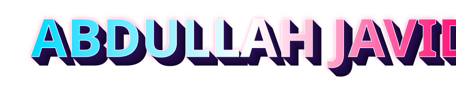
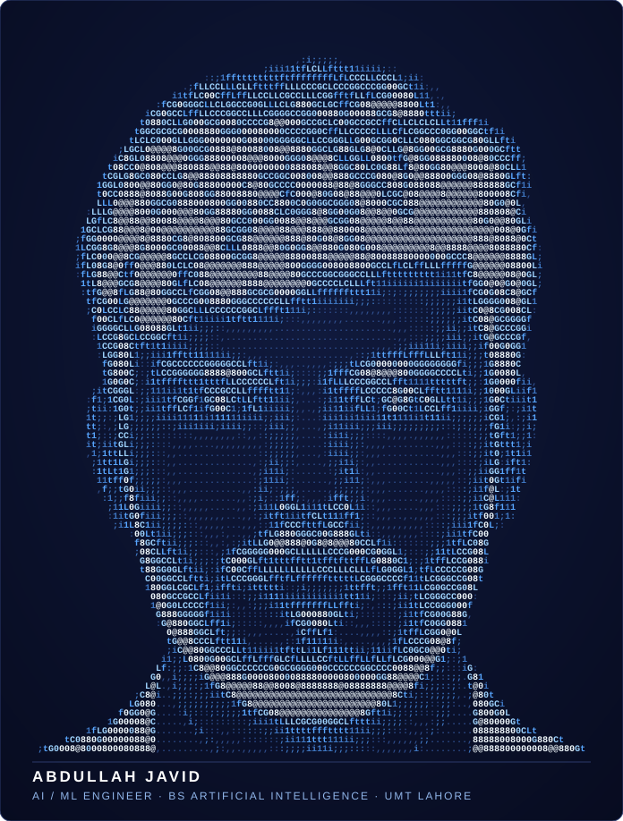
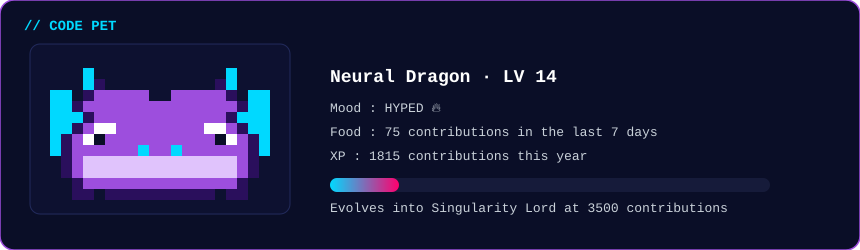

   

## 🧑‍💻 Recruiter Snapshot (30-second read)

| | |
|---|---|
| **Role** | AI Developer · ML Engineer · Builder & Deployer |
| **Education** | BS Artificial Intelligence @ UMT Lahore (2025–2029) · CGPA 3.54/4.0 |
| **Experience** | ML Intern @ FlyRank AI (Jul–Aug 2026) · Associate Trainee @ SPHERE Consulting (Aug–Sep 2026) |
| **Core stack** | Python · PyTorch · TensorFlow · YOLOv8 · OpenCV · FastAPI · Next.js · TypeScript · C++ |
| **LLM / GenAI** | Claude API · GPT-4 · Gemini · Groq · Whisper · ChromaDB · Pinecone · RAG |
| **Shipped** | 30+ live projects across 7+ platforms (HF Spaces, Vercel, Render, Railway, GitHub Pages, itch.io, Streamlit Cloud) |
| **Languages** | Urdu (native) · English (professional) |
| **Location** | Lahore, Pakistan · open to internships / remote |
| **Contact** | [mabdullah.ab614@gmail.com](mailto:mabdullah.ab614@gmail.com) |

**⭐ Best proof of work (click to try live):**
[🧠 NeuroScan AI · 92.2%](https://huggingface.co/spaces/Abdullah-Javid/brain-tumor-detector) ·
[🔬 Lung Cancer Vision · 99.73%](https://huggingface.co/spaces/Abdullah2894830/lung-cancer-vision) ·
[🌿 Sage AI · RAG](https://sage-ai-q9bvrp6nmajtrxp9rp9zna.streamlit.app/) ·
[🧠 NeuroMail AI · Groq](https://neuromail-ai-1.onrender.com) ·
[📍 Roll Call · Next.js + Supabase](https://school-dropout-enrollment-tracker.vercel.app/) ·
[📝 Notes API · FastAPI](https://fastapi-notes-api-6rpc.onrender.com/docs)

## 🃏 Holo Card &nbsp;&amp;&nbsp; 🐾 Code Pet

<table>
<tr>
<td align="center"> Stats update from my live GitHub data</td>
<td align="center"> My pet evolves as I commit. Stop coding and it starves 😴</td>
</tr>
</table>

## 🏙️ Contribution City

## 🌃 Neon Skyline

          

## 🚀 Featured Projects

| # | Project | What it is | Stack | Live |
|---|---|---|---|---|
| 1 | 🔬 **Skin Disease Detector** | ResNet18 · 71.8% · 9 conditions | PyTorch, Gradio | [▶ Live](https://huggingface.co/spaces/BUDDDY2894830/skin-disease-detector) |
| 2 | 🤖 **Nexus AI Assistant** | Groq · 4 LLMs · 10 languages + web | Gradio, Groq | [▶ Live](https://huggingface.co/spaces/BUDDDY2894830/nexus-ai-assistant) |
| 3 | 🐾 **Animal Detector** | YOLOv8 · 10 species real-time | OpenCV, Gradio | [▶ Live](https://huggingface.co/spaces/BUDDDY2894830/animal-detector) |
| 4 | 💊 **Tablet Defect Inspector** | ResNet18 · Good vs Defective | PyTorch, Gradio | [▶ Live](https://huggingface.co/spaces/BUDDDY2894830/tablet-defect-inspector) |
| 5 | ✍️ **Air Writer** | MediaPipe · 30fps · zero hardware | OpenCV, Gradio | [▶ Live](https://huggingface.co/spaces/Abdullah2894830/air-writer) |
| 6 | ♟️ **ChessMaster** | Minimax + Alpha-Beta · 20+ openings · ELO | TypeScript | [▶ Live](https://mabdullahab614-alt.github.io/chessmaster/) |
| 7 | 🎮 **Galactic Defender** | Pygame → WASM · boss battle · 3 modes | Pygame | [▶ Live](https://aabdullah2894830.itch.io/galactic-defender-absolute-zero) |
| 8 | ⚡ **SURGE** | C++17 + raylib → WASM · 3 stages · 3 bosses | C++, raylib | [▶ Live](https://mabdullahab614-alt.github.io/surge/) |
| 9 | 🐍 **Snake Strike** | Canvas API · Web Audio · mobile | JavaScript | [▶ Live](https://mabdullahab614-alt.github.io/snake-strike/) |
| 10 | 🌐 **Portfolio Website** | Next.js 15 · neural net · 3D effects | Next.js, Framer | [▶ Live](https://mabdullahab614-alt.github.io/abdullah-portfolio/) |
| 11 | ⚡ **Quick Summarizer** | Frequency scoring · 48.6% compression · zero deps | HTML, JS | [▶ Live](https://mabdullahab614-alt.github.io/quick-summarizer) |
| 12 | 🧠 **Sentiment Snap** | DistilBERT · 99.99% confidence | Python, Streamlit | [▶ Live](https://huggingface.co/spaces/Abdullah2894830/sentiment-snap) |
| 13 | 🎮 **Mind Bender** | Minimax + Alpha-Beta · unbeatable AI · 3 modes | Python, Gradio | [▶ Live](https://huggingface.co/spaces/Abdullah2894830/mind-bender-game) |
| 14 | 👻 **Phantom Writer** | Hybrid stylometric AI detector + humanizer | Python, Flask | [▶ Live](https://phantom-writer.onrender.com) |
| 15 | 🛡️ **Mail Sentinel** | TF-IDF + Naive Bayes · 97%+ accuracy | Python, Streamlit | [▶ Live](https://mail-sentinel-hy47.onrender.com) |
| 16 | 🖩 **Calculator by Abdullah** | C# → Web · scientific · dark UI | HTML, JS, C# | [▶ Live](https://calculator-by-abdullah.onrender.com) |
| 17 | 🧠 **NeuroScan AI** | ResNet18 · brain tumor · 4 classes · 92.2% | PyTorch, Gradio | [▶ Live](https://huggingface.co/spaces/Abdullah-Javid/brain-tumor-detector) |
| 18 | ✏️ **HandScan AI** | CNN · MNIST · 99.28% accuracy | TensorFlow, Gradio | [▶ Live](https://huggingface.co/spaces/Abdullah2894830/handwritten-character-recognition) |
| 19 | ⚡ **TrackFlow** | Vanilla JS PWA · habit grid · streaks | HTML, JS, CSS | [▶ Live](https://mabdullahab614-alt.github.io/trackflow/) |
| 20 | 🔬 **Lung Cancer Vision** | MobileNetV2 · 3 classes · 99.73% | TensorFlow, Gradio | [▶ Live](https://huggingface.co/spaces/Abdullah2894830/lung-cancer-vision) |
| 21 | ♻️ **Garbage Classifier** | EfficientNetB0 · 12 classes · 96.16% · 15K images | TensorFlow | [▶ Live](https://huggingface.co/spaces/Abdullahjavid/garbage-classifier) |
| 22 | 🎬 **Movie Suggester** | TMDB API · actor search · trailer popup | Python, Gradio | [▶ Live](https://huggingface.co/spaces/Abdullahjavid/movie-suggester) |
| 23 | 🩺 **Clinical Diagnostics Engine** | XGBoost (tuned) · 90% ROC-AUC (5-fold CV) | Python, Streamlit | [▶ Live](https://interngrowclinicaldiagnosticsengine-fucgymvnjuquzvxxq6kxhw.streamlit.app) |
| 24 | 🧠 **NeuroMail AI** | Groq Llama 3.3 70B · Gmail API · batch drafting | Python, Gradio | [▶ Live](https://neuromail-ai-1.onrender.com) |
| 25 | 🔎 **Face Recognition Studio** | dlib ResNet · 128-D encoding + match scoring | Python, Gradio | [▶ Live](https://huggingface.co/spaces/ABDULLAH-JAVID04/face-recognition-demo) |
| 26 | 🎓 **Studienkompass** | Vanilla JS · 132 universities · 12 unit tests | HTML, CSS, JS | [▶ Live](https://mabdullahab614-alt.github.io/studienkompass/) |
| 27 | 📍 **Roll Call** | Next.js + Supabase · 25.1M out-of-school tracked · 132+ districts | Next.js, TypeScript | [▶ Live](https://school-dropout-enrollment-tracker.vercel.app/) |
| 28 | 🌿 **Sage AI** | Groq LLM + ChromaDB RAG · voice & vision | Python, Streamlit | [▶ Live](https://sage-ai-q9bvrp6nmajtrxp9rp9zna.streamlit.app/) |
| 29 | 📝 **Notes API** | FastAPI · async SQLAlchemy 2.0 · Pydantic v2 · Swagger | FastAPI, SQLite | [▶ Live](https://fastapi-notes-api-6rpc.onrender.com/docs) |

## 📊 GitHub Stats

   

## 📜 License & Usage

**All Rights Reserved © 2026 Abdullah Javid**

This profile and every project listed above (source code, ideas, designs, trained models and documentation) is publicly visible **for portfolio and demonstration purposes only**. No part of any linked repository may be copied, modified, distributed, sublicensed or used, for personal, educational or commercial purposes, without explicit prior written permission from the author. Forking or cloning does **not** grant any rights.

📧 [mabdullah.ab614@gmail.com](mailto:mabdullah.ab614@gmail.com) · 🔗 [GitHub](https://github.com/mabdullahab614-alt) · 💼 [LinkedIn](https://linkedin.com/in/abdullah-javid-b217a2384)

