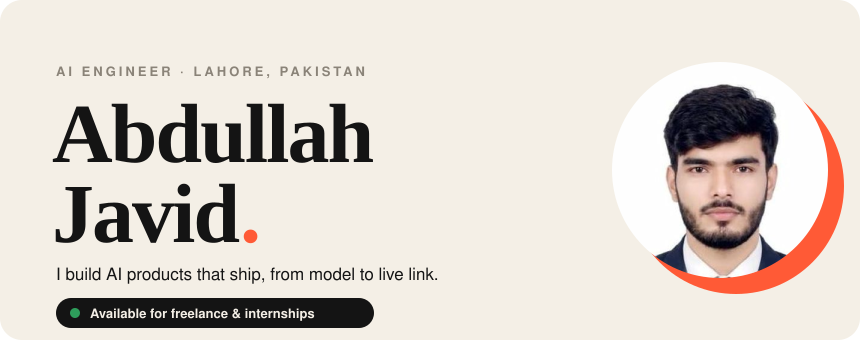
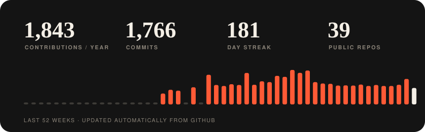

 

    

 

## What I build

| Computer vision & medical AI | LLM apps & RAG | Full-stack AI products |
|---|---|---|
| Image classifiers and detectors trained with PyTorch / TensorFlow and shipped as live demos. | Chat, document Q&A and email agents on Groq, ChromaDB and the Gmail API. | Next.js, FastAPI and Laravel dashboards and APIs, taken from idea to live deployment. |

**Toolbox:** Python · PyTorch · TensorFlow · YOLOv8 · OpenCV · FastAPI · Next.js · TypeScript · PHP · Laravel · C++ · Groq · ChromaDB · Gradio · Streamlit

 

## Selected work

Every project below runs live. Click and try it.

| Project | What it does | Result |
|---|---|---|
| **[NeuroScan AI](https://huggingface.co/spaces/Abdullah-Javid/brain-tumor-detector)** | Brain tumor detection from MRI (ResNet18, 4 classes) | 92.2% accuracy |
| **[Lung Cancer Vision](https://huggingface.co/spaces/Abdullah2894830/lung-cancer-vision)** | Lung scan classifier (MobileNetV2, 3 classes) | 99.73% accuracy |
| **[Sage AI](https://sage-ai-q9bvrp6nmajtrxp9rp9zna.streamlit.app/)** | Chat and document Q&A with RAG, voice and vision | Groq + ChromaDB |
| **[NeuroMail AI](https://neuromail-ai-1.onrender.com)** | Email reply agent that drafts up to 30 emails at once | Llama 3.3 70B + Gmail API |
| **[Roll Call](https://school-dropout-enrollment-tracker.vercel.app/)** | District-level tracker for out-of-school children | 25.1M children, 132+ districts |
| **[Clinical Diagnostics Engine](https://interngrowclinicaldiagnosticsengine-fucgymvnjuquzvxxq6kxhw.streamlit.app)** | Heart disease risk prediction (tuned XGBoost) | 90% ROC-AUC |

<b>See all 29 live projects</b>

 

[Skin Disease Detector](https://huggingface.co/spaces/BUDDDY2894830/skin-disease-detector) · [Nexus AI Assistant](https://huggingface.co/spaces/BUDDDY2894830/nexus-ai-assistant) · [Animal Detector](https://huggingface.co/spaces/BUDDDY2894830/animal-detector) · [Tablet Defect Inspector](https://huggingface.co/spaces/BUDDDY2894830/tablet-defect-inspector) · [Air Writer](https://huggingface.co/spaces/Abdullah2894830/air-writer) · [Garbage Classifier](https://huggingface.co/spaces/Abdullahjavid/garbage-classifier) · [HandScan AI](https://huggingface.co/spaces/Abdullah2894830/handwritten-character-recognition) · [Face Recognition Studio](https://huggingface.co/spaces/ABDULLAH-JAVID04/face-recognition-demo) · [Sentiment Snap](https://huggingface.co/spaces/Abdullah2894830/sentiment-snap) · [Mail Sentinel](https://mail-sentinel-hy47.onrender.com) · [Phantom Writer](https://phantom-writer.onrender.com) · [Movie Suggester](https://huggingface.co/spaces/Abdullahjavid/movie-suggester) · [Notes API](https://fastapi-notes-api-6rpc.onrender.com/docs) · [Studienkompass](https://mabdullahab614-alt.github.io/studienkompass/) · [Quick Summarizer](https://mabdullahab614-alt.github.io/quick-summarizer) · [TrackFlow](https://mabdullahab614-alt.github.io/trackflow/) · [Calculator](https://calculator-by-abdullah.onrender.com) · [Portfolio Website](https://mabdullahab614-alt.github.io/abdullah-portfolio/)

**Games:** [ChessMaster](https://mabdullahab614-alt.github.io/chessmaster/) · [Mind Bender](https://huggingface.co/spaces/Abdullah2894830/mind-bender-game) · [Galactic Defender](https://aabdullah2894830.itch.io/galactic-defender-absolute-zero) · [SURGE](https://mabdullahab614-alt.github.io/surge/) · [Snake Strike](https://mabdullahab614-alt.github.io/snake-strike/)

 

## This year on GitHub

 

## Experience

**ML Intern, FlyRank AI** &nbsp;·&nbsp; Jul to Aug 2026 &nbsp;·&nbsp; Remote 
Built and deployed deep learning and computer vision applications as part of the July 2026 cohort, and cut model inference time by 35%.

**Associate Trainee, SPHERE Consulting** &nbsp;·&nbsp; Aug to Sep 2026 &nbsp;·&nbsp; Lahore, on-site 
Took dashboards from idea to live production in a public health consulting environment using PHP and Laravel: UI/UX, backend, database queries, Git and GitHub, deployment, and live support.

**BS Artificial Intelligence, UMT Lahore** &nbsp;·&nbsp; 2025 to 2029

 

## Let's work together

I take on freelance AI projects and internships: model training, LLM apps, and getting prototypes live. Tell me what you want to build.

**[mabdullah.ab614@gmail.com](mailto:mabdullah.ab614@gmail.com)**

 

All Rights Reserved © 2026 Abdullah Javid. Code, designs and models in my repositories are shown for portfolio purposes. Please ask before reusing anything.
